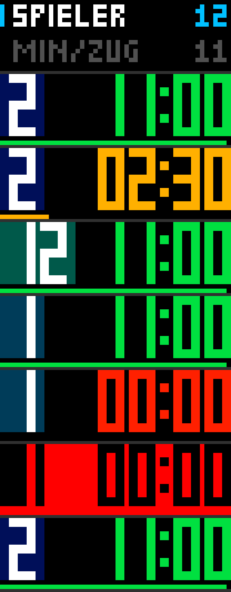

# Zuguhr

Eine Uhr für Spielzüge auf der Ulanzi TC002 (52×16) mit [AWTRIX NG](https://github.com/Blueforcer/awtrix-ng):
n Spieler, höchstens x Minuten je Zug. Wer seinen Zug beendet, startet den Timer des nächsten Spielers.
Alles wird an der Uhr eingestellt und mit ihren Tasten bedient.

Von oben nach unten: Einstellen, laufender Zug, letztes Viertel der Zeit, Spieler 12, Zeit abgelaufen.

## Installieren

1. Im Web-UI der Uhr den Reiter **Scripts** öffnen und mit **+** ein neues Skript `Zuguhr` anlegen.
2. Den Inhalt von [`Zuguhr.ax`](Zuguhr.ax) einfügen und speichern.
3. An der Uhr die mittlere Taste eine halbe Sekunde halten, **Scripts** wählen, dann **Zuguhr**.

Die Zuguhr läuft nicht in der App-Rotation, sondern nur, wenn sie so gestartet wird.

## Bedienung

### Einstellen

| Eingabe | Wirkung |
|---|---|
| Knopf drehen, linke oder rechte Taste | Wert ändern (2-12 Spieler, 1-60 Minuten je Zug) |
| Knopf drücken | zwischen „Spieler" und „Min/Zug" wechseln |
| Mittlere Taste | Spiel starten, Spieler 1 beginnt |

Die Werte bleiben gespeichert.

### Im Spiel

| Eingabe | Wirkung |
|---|---|
| Mittlere Taste | Zug beenden, der Timer des nächsten Spielers startet |
| Linke Taste | einen Spieler zurück |
| Rechte Taste oder Knopf drücken | Pause und Weiter |
| Knopf halten | zurück zum Einstellen |
| Mittlere Taste halten | Zuguhr beenden |

## Anzeige

- Links die Spielernummer auf einem Feld in der Farbe des Spielers, rechts die Restzeit, unten ein Balken.
- Die Zeit ist grün, im letzten Viertel gelb und in den letzten 10 Sekunden rot.
- In den letzten 5 Sekunden tickt es. Bei Ablauf ertönt ein Signal und die Anzeige blinkt rot, bis die
  mittlere Taste gedrückt wird.

## Einstellungen im Web-UI

Unter **Apps** hinter dem Zahnrad der Zuguhr:

- **Spieler** und **Minuten je Zug**: dieselben Werte wie an der Uhr
- **Töne**: Signale ein oder aus
- **Nach Ablauf automatisch weiter**: bei abgelaufener Zeit sofort zum nächsten Spieler

## Stand

Geprüft im AWTRIX-NG-Simulator, Version 1.2.3, mit 52×16 Pixeln. Tasten und Knopf wurden dort nur
simuliert.
